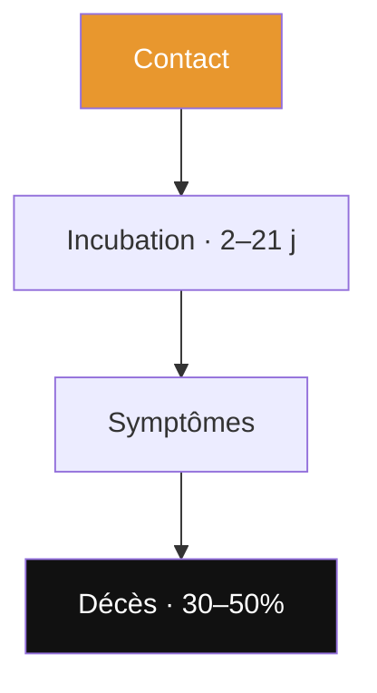

# Guide — rédiger une présentation pour « md Viewer » (mode Diaporama)

Ce guide décrit le format Markdown qu'attend le **mode Diaporama** de *md Viewer* et donne les
bonnes pratiques pour un rendu net en plein écran. Il sert aussi d'instructions à coller dans une
configuration d'assistant (Claude, etc.) pour générer des présentations directement exploitables.

> Le diaporama s'ouvre via le bouton **▶︎ Diaporama** du lecteur, visible dès qu'un document
> contient **au moins 2 diapositives**.

---

## Structure du fichier

Produire **un seul fichier Markdown** (`.md`).

1. **Frontmatter YAML** en tête (recommandé) :
   ```yaml
   ---
   title: Titre de la présentation
   date: 2026-05-19          # format AAAA-MM-JJ
   type: presentation
   tags: [sujet, theme]
   ---
   ```
2. **Une diapositive par bloc**, séparées par une ligne contenant uniquement `---`.
   - Le `---` de fermeture du frontmatter ne compte pas comme séparateur.
   - Les `---` situés **dans** un bloc de code ` ``` ` sont ignorés.

---

## Règle d'or : une idée par diapositive

Le moteur **réduit automatiquement** une diapo trop chargée → elle devient petite. Garder chaque
diapo aérée :

- Diapo de texte : **≤ ~40 mots**, **≤ 6 puces**.
- Tableau : **≤ 6 lignes / 4 colonnes**.
- **1 seule idée** et **1 seul média principal** par diapo.

Préférer **plus de diapos courtes** que peu de diapos denses.

---

## Images inline (par URL)

Syntaxe : ``

- Utiliser des **URL HTTPS publiques et directes** vers un fichier image (`.jpg`/`.png`/`.webp`),
  chargeables sans authentification ni anti-hotlink (Wikimedia, CDN d'actualité, etc.).
- **Une seule image par diapo** : elle est alors **agrandie pour remplir la diapo**. Plusieurs
  images sur une même diapo restent petites → à éviter.
- **Haute résolution** : les petites images sont mises à l'échelle et deviennent floues. Viser
  **≥ 1000 px sur le grand côté** (davantage si l'image occupe toute la diapo).
  *Astuce Wikimedia* : dans une URL `…/thumb/…/500px-Nom.jpg`, remplacer `500px` par `1280px`.
- **Légende** : ajouter une citation juste sous l'image :
  ```markdown
  

  > Nom · rôle · détail clé en **gras**
  ```
- Les **URL injoignables sont supprimées silencieusement** à l'affichage → vérifier que chaque lien
  renvoie bien une image (pas une page HTML).
- Dans l'app, **un tap sur l'image l'ouvre en plein écran** (zoom).

---

## Contenu pris en charge sur une diapositive

- **Titres** `#` (titre principal), `##` (titre de diapo), `###`.
- **Gras**, *italique*, listes, **tableaux** (GFM), citations `>`.
- **Diagrammes Mermaid** — bloc ` ```mermaid ` : `flowchart`, `timeline`, `pie`, `quadrantChart`,
  `xychart-beta`, `sequenceDiagram`… Garder lisible (**≤ ~8 nœuds**). Saut de ligne dans un libellé
  = `\n`. Palette OK-ia possible :
  ```mermaid
  flowchart TD
    A["Contact"] --> B["Décès 30–50%"]
    style A fill:#E8972E,color:#fff
    style B fill:#111,color:#fff
  ```
  Couleurs utiles : orange `#E8972E`, noir `#111`, vert `#2d5a1b`, bleu `#1a3a5c`.
- **Cartes interactives** — bloc ` ```leaflet ` (remplit la diapo) :
````markdown
```leaflet
id: carte-unique
lat: 1.5
long: 28.5
defaultZoom: 4
marker: default,1.57,30.22,[[Bunia · épicentre]]
marker: default,-1.68,29.22,[[Goma]]
```
````
- **Callouts** Obsidian : `> [!warning] Titre`, `[!note]`, `[!tip]`, `[!info]`…
- **Liens wiki** `[[Nom]]` (affichés stylés).

---

## Modèles de diapositives

- **Titre** : `#` Titre + `##` sous-titre + `>` source/auteur.
- **Idée clé** : `##` Titre + 3–5 puces **ou** un tableau court.
- **Visuel** : `##` Titre + 1 image (ou 1 diagramme, ou 1 carte) + `>` légende.
- **Citation** : une `>` courte et forte, rien d'autre.

---

## Notes de l'orateur

Les notes s'écrivent dans le fichier, dans un commentaire HTML placé dans la diapositive, avant le
`---` qui la sépare de la suivante :

```markdown
## Les chiffres de l'année

- 486 articles analysés

<!--
Insister sur la hausse de 18 %.
-->

---
```

Le mode présentateur (option Analytic, second écran) les affiche ; le public ne les voit pas. Un
PowerPoint importé arrive avec ses notes déjà rangées ainsi, et l'export PowerPoint les remet dans
la page de notes de chaque diapositive (1.5).

**Les écrire dans l'app (1.5, option Analytic).** Dans le diaporama, le bouton **Notes** (à droite
d'« Annoter ») ouvre la note de la diapositive affichée ; en mode présentateur, le crayon à côté de
« Notes de l'orateur » fait de même. **Enregistrer** l'écrit dans le fichier, en commentaire à la fin
de la diapositive, comme ci-dessus ; une note vide est retirée. Le fichier reste du Markdown que
tout éditeur lit. Écrire une note ne touche pas aux annotations du document. Le bouton n'apparaît
que pour un fichier Markdown (`.md`, `.markdown`, `.txt`) que l'app peut modifier : pas pour
l'exemple intégré, ni pour un Word, un PDF ou un PowerPoint ouvert tel quel.

**Les faire proposer par la conversion (1.5, option Analytic).** « Convertir en présentation »
propose, si l'on coche **Proposer des notes de l'orateur** (jamais coché d'avance), deux ou trois
phrases par diapositive de texte, tirées de sa section du rapport. Chaque phrase passe la même
vérification que les puces : une phrase dont un nombre n'est pas dans la section est écartée, et
comptée sous « Laissé de côté ». Les notes s'écrivent comme ci-dessus ; on les reprend ensuite dans
l'app ou dans tout éditeur. Mesuré au banc (`tools/ConversionBench`, `--notes`) : pas de temps de
plus sensible, aucune phrase écartée sur un rapport français et un rapport allemand.

Deux précisions :

- `--` fermerait le commentaire : l'app le remplace par un tiret long (—), comme l'import.
- Tous les commentaires d'une diapositive sont des notes, sauf les marques internes de l'app
  (`okia:…`, `fornews:…`) ; quand l'app réécrit une note, elle les réunit en un seul commentaire.

## À ne pas faire

- Pas de diapos « murs de texte » (elles rétrécissent).
- Pas plusieurs grosses images / diagrammes sur la même diapo.
- Ne **pas** gérer les transitions dans le Markdown : elles se choisissent dans l'app (menu **⚙**).
  Se concentrer sur le contenu.

---

## Commandes du diaporama (côté lecteur)

| Action | Geste / touche |
|--------|----------------|
| Diapo suivante / précédente | flèches **←/→**, **espace**, balayage tactile, flèches à l'écran |
| Choisir le **thème** | bouton **⚙** (Clair, Sombre, Console, Sépia, Océan) |
| Choisir la **transition** | bouton **⚙** (Fondu, Poussée, Entrée, Échelle, Retournement 3D) |
| **Vue d'ensemble** (grille de vignettes) | bouton **▦**, puis cliquer une vignette |
| **Exporter en PowerPoint** (.pptx mixte) | bouton **⚙** → section **Export** → *PowerPoint (.pptx)* |
| **Quitter** le diaporama | bouton **✕** ou touche **Échap** |

> **Traduction (1.2).** Si le document ouvert dans le lecteur est traduit, le diaporama l'est
> aussi : chaque diapositive se traduit à son apparition, et l'export PowerPoint traduit d'abord
> celles que personne n'a encore ouvertes — un fichier à moitié traduit serait pire que pas
> traduit du tout. Le diaporama n'offre pas de retour à l'original : il est en plein écran, sans
> chrome ; on en sort pour retrouver le document.

---

## Exemple minimal

````markdown
---
title: Ebola Bundibugyo 2026
type: presentation
---

# 🦠 Ebola Bundibugyo
## Retour d'un spectre africain

> Rapport de veille · 19 mai 2026

---

## Situation au 18 mai

| Indicateur | Valeur |
|-----------|--------|
| Décès probables | **91** |
| Cas suspects | **350** |

---

## Progression clinique



---

## Jean-Jacques Muyembe


> Virologue congolais · Co-découvreur d'Ebola en **1976**
````

> **Livraison attendue d'un assistant** : un fichier `.md` complet, prêt à ouvrir dans *md Viewer*
> puis ▶︎ Diaporama.
