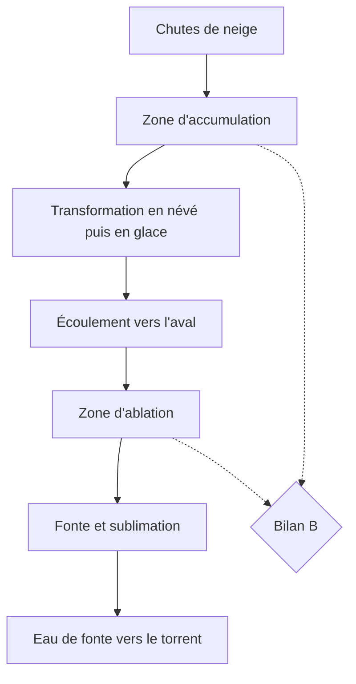
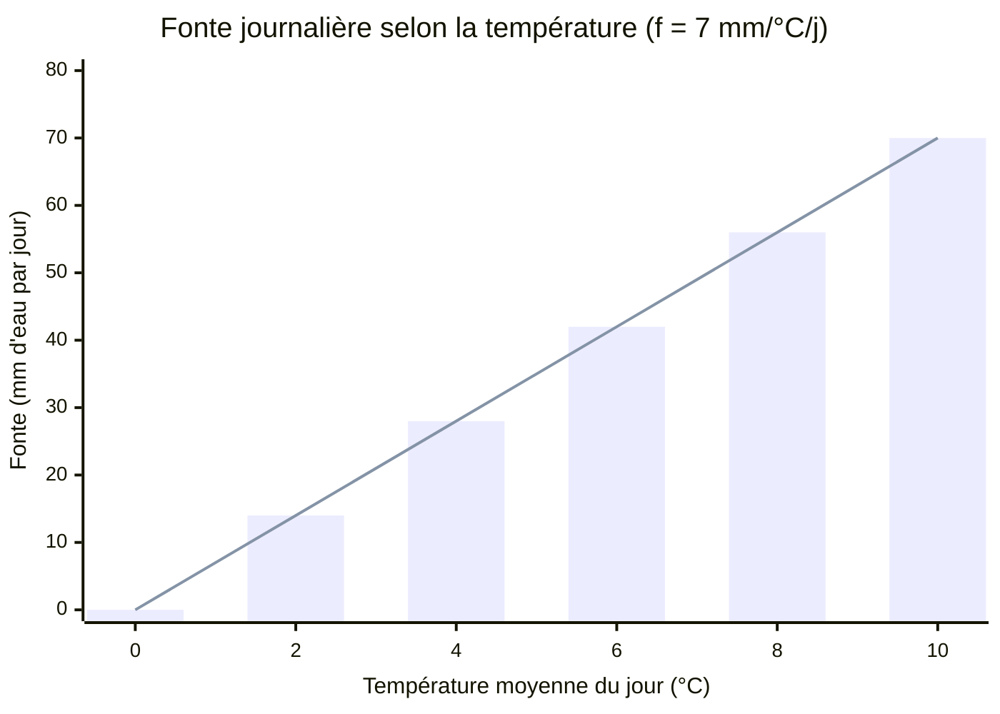
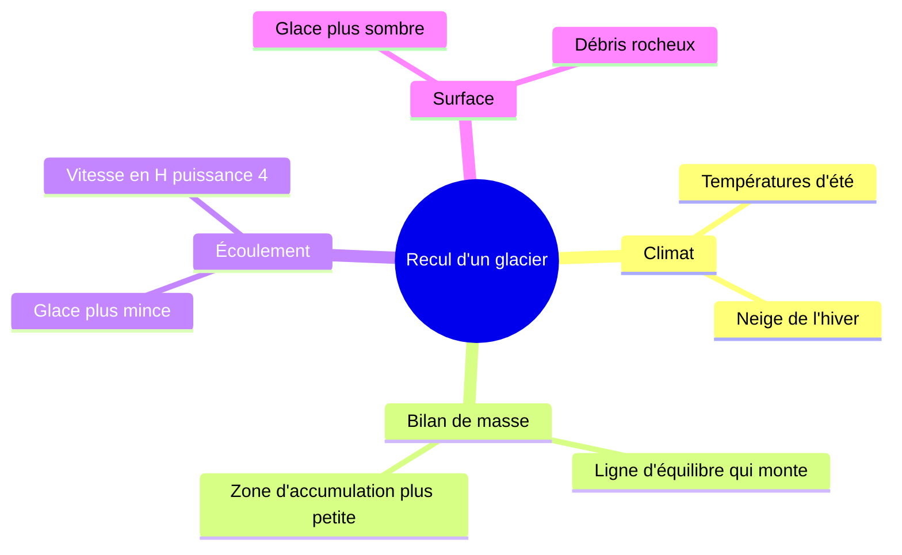
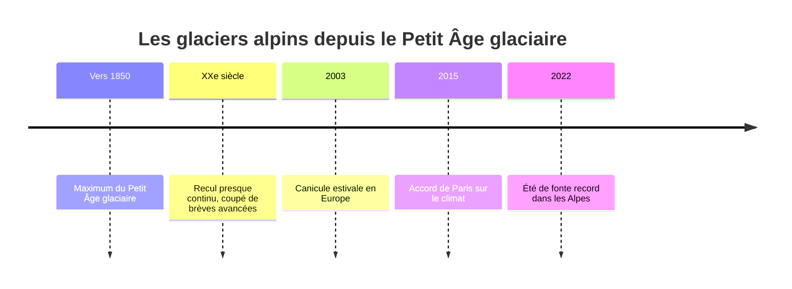

# Le recul des glaciers alpins

Depuis le maximum du Petit Âge glaciaire, vers 1850, les glaciers des Alpes reculent. Ce
rapport rappelle les trois lois physiques qui gouvernent ce recul : le **bilan de masse**, qui
dit ce que le glacier gagne et perd, la **fonte**, qui suit la température de l'air, et
l'**écoulement** de la glace, qui ramène vers le bas ce qui s'accumule en haut. Les calculs
sont des ordres de grandeur, faits avec des valeurs de manuel.

> [!info] À retenir
> Un glacier n'est pas un bloc immobile : c'est un fleuve de glace très lent. Il grandit
> quand il reçoit plus de neige qu'il ne perd de glace, et recule dans le cas contraire.

## Six glaciers des Alpes

Les plus connus, de la France à l'Autriche : le [[Glacier d'Aletsch]], le plus grand des
Alpes, le [[Glacier du Rhône]], source du fleuve, le [[Glacier du Gorner]] au pied du Mont
Rose, le [[Glacier de Morteratsch]] dans les Grisons, la [[Mer de Glace]], le plus grand de
France, et la [[Pasterze]], le plus grand d'Autriche.

```leaflet
id: glaciers-alpins
minZoom: 5
maxZoom: 12
height: 440px
marker: 46.505, 8.035, [[Glacier d'Aletsch]]
marker: 46.620, 8.400, [[Glacier du Rhône]]
marker: 45.970, 7.800, [[Glacier du Gorner]]
marker: 46.420, 9.935, [[Glacier de Morteratsch]]
marker: 45.920, 6.930, [[Mer de Glace]]
marker: 47.100, 12.700, [[Pasterze]]
```

> [!tip] Sur place
> Le long du sentier du [[Glacier de Morteratsch]], des panneaux marquent la position du front
> année après année : on marche dans le recul du glacier.

## Le bilan de masse

En chaque point de la surface, le bilan local $\dot b$ est la somme de l'accumulation $c$
(la neige qui tombe et reste) et de l'ablation $a$ (la fonte et la sublimation, comptée
négativement) :

$$
\dot b = c + a
$$

Le bilan du glacier entier s'obtient en intégrant sur sa surface $S$ :

$$
B = \int_{S} \dot b \; dS
$$

En haut, l'accumulation l'emporte ; en bas, l'ablation. La **ligne d'équilibre** sépare les
deux zones : là, $\dot b = 0$. Quand le climat se réchauffe, elle monte, la zone
d'accumulation rétrécit, et $B$ devient négatif.

![Coupe d'un glacier de vallée : la zone d'accumulation en haut, la ligne d'équilibre, la zone d'ablation, l'écoulement vers le front, la moraine et le torrent][svg-coupe]



## La fonte suit la température

### La température baisse avec l'altitude

Dans l'atmosphère libre, la température diminue d'environ $\gamma \approx 6{,}5$ °C par
kilomètre. Connaissant la température $T(z_0)$ à une station d'altitude $z_0$ :

$$
T(z) = T(z_0) - \gamma \, (z - z_0)
$$

Une station à 1500 m mesure 15 °C : à 2500 m, sur la langue du glacier, il fait environ
$15 - 6{,}5 = 8{,}5$ °C.

### Le modèle degré-jour

La fonte $M$ (en millimètres d'eau) est proportionnelle à la somme des températures
positives, au-dessus d'un seuil $T_0$ voisin de 0 °C :

$$
M = f_{DD} \sum_{t=1}^{N} \max\left(T_t - T_0,\ 0\right)
$$

Le facteur $f_{DD}$ vaut quelques millimètres par degré et par jour, plus pour la glace,
sombre, que pour la neige, qui réfléchit davantage la lumière. Avec $f_{DD} = 7$ mm/(°C·j),
trente jours à 8 °C de moyenne font fondre :

$$
M = 7 \times 8 \times 30 = 1680 \ \text{mm d'eau} \approx 1{,}7 \ \text{m}
$$



### L'énergie qu'il faut

Faire fondre une épaisseur $\Delta h$ de glace demande l'énergie, par mètre carré :

$$
Q = \rho_i \, L_f \, \Delta h
$$

| Grandeur | Symbole | Valeur |
|---|---|---|
| Masse volumique de la glace | $\rho_i$ | 917 kg/m³ |
| Chaleur latente de fusion | $L_f$ | 334 kJ/kg |
| Accélération de la pesanteur | $g$ | 9,81 m/s² |
| Constante de Stefan-Boltzmann | $\sigma$ | $5{,}67 \times 10^{-8}$ W/(m²·K⁴) |
| Exposant de la loi de Glen | $n$ | environ 3 |

Pour un mètre de glace : $Q = 917 \times 334\,000 \times 1 \approx 3{,}1 \times 10^{8}$ J/m²,
soit 306 mégajoules par mètre carré.

> [!warning] Un effet qui s'emballe
> Quand la neige fond, la glace apparaît : plus sombre, elle absorbe davantage de soleil et
> fond plus vite. C'est pourquoi une année sans neige d'été coûte si cher à un glacier.

![Le soleil chauffe la surface : la neige fraîche renvoie la plupart du rayonnement, la glace nue en absorbe bien davantage ; l'air chaud et le vent apportent aussi de la chaleur][svg-energie]

## L'écoulement de la glace

La glace se déforme comme un fluide très visqueux. La **loi de Glen** relie la vitesse de
déformation $\dot\varepsilon$ à la contrainte $\tau$ :

$$
\dot\varepsilon = A \, \tau^{\,n}
$$

où $A$ dépend de la température de la glace. Sous un glacier d'épaisseur $H$, sur une pente
$\alpha$, la contrainte au fond vaut :

$$
\tau_b = \rho_i \, g \, H \sin\alpha
$$

Pour $H = 300$ m et $\alpha = 3°$ :
$\tau_b = 917 \times 9{,}81 \times 300 \times \sin 3° \approx 1{,}4 \times 10^{5}$ Pa,
soit environ 140 kPa, dans la fourchette habituelle des glaciers de vallée.

En intégrant la loi de Glen sur l'épaisseur, on obtient la vitesse due à la déformation, entre
le fond et la surface :

$$
u_s - u_b = \frac{2A}{n+1} \left( \rho_i \, g \sin\alpha \right)^{n} H^{\,n+1}
$$

Avec $n = 3$, la vitesse croît comme $H^{4}$ : un glacier qui perd la moitié de son
épaisseur coule seize fois moins vite par déformation. Il ne ramène plus assez de glace vers
le bas, et son front recule.

![Profil de vitesse dans l'épaisseur d'un glacier : lente près du fond, où la glace glisse et se déforme, la plus rapide en surface][svg-vitesse]



## Repères dans le temps

![Schéma du recul du front : la position vers 1850, marquée par la moraine du Petit Âge glaciaire, et le front d'aujourd'hui, plus haut dans la vallée][svg-recul]



## Conclusion

Trois lois suffisent à comprendre le recul : un bilan de masse qui devient négatif quand la
ligne d'équilibre monte, une fonte qui croît avec chaque degré, et un écoulement qui ralentit
fortement quand la glace s'amincit. Chacune aggrave l'autre.

> [!note] Méthode
> Les formules sont celles des manuels de glaciologie ; les valeurs numériques sont des ordres
> de grandeur, choisis pour l'illustration. Ce document montre ce que md Viewer affiche :
> formules, diagrammes Mermaid, carte et encadrés, dans un seul fichier Markdown.

<!-- images -->
[svg-coupe]: 
[svg-energie]: 
[svg-vitesse]: 
[svg-recul]: 
