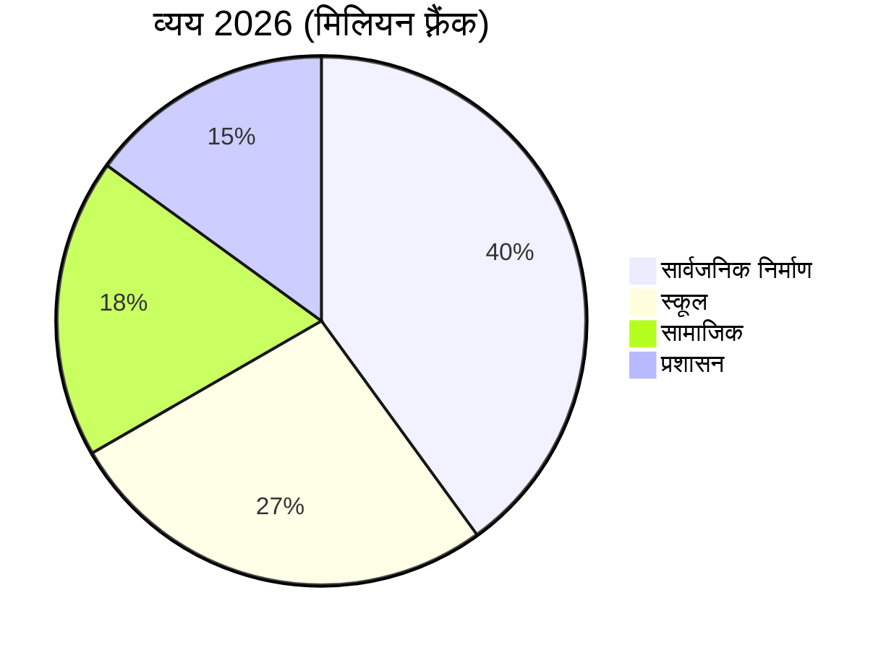

# वार्षिक रिपोर्ट 2026

[[Montagny]] नगरपालिका बीते वर्ष पर एक नज़र डालती है: निर्माण की तीन परियोजनाएँ पूरी हुईं,
एक धरोहर स्थल का जीर्णोद्धार हुआ और ख़र्च बजट के 2.3% के दायरे में रहा।


## सार्वजनिक निर्माण कार्य

झील मार्ग परियोजना अप्रैल में, स्वीकृत समय-सारिणी से दो महीने पहले पूरी हुई। इस पर
1.8 मिलियन फ़्रैंक की लागत आई, जो नगर परिषद द्वारा स्वीकृत राशि से 1,20,000 फ़्रैंक कम है।
1962 में बिछाई गई पेयजल की मुख्य पाइपलाइन 900 मीटर की लंबाई में बदली गई।

गर्मियों में फ़ोंतेन स्कूल में ऊष्मा-रोधन का काम हुआ: अगली सर्दियों से हीटिंग की खपत 35% तक
घटने की उम्मीद है। योजना के अनुसार, अगस्त में नया सत्र शुरू होते ही छात्र अपनी कक्षाओं में लौट आए।

सड़कों की सारी रोशनी अब एलईडी है: 412 लाइटें बदली गईं, और मोहल्लों से परामर्श के बाद रात 1 से
सुबह 5 बजे तक इन्हें आंशिक रूप से बंद रखने का निर्णय लिया गया।


## धरोहर

अठारह महीनों के जीर्णोद्धार के बाद सेंट-जाँ चैपल के 15वीं सदी के भित्तिचित्र फिर से निखर उठे हैं।
निर्देशित भ्रमण वसंत में फिर शुरू होंगे, हर महीने के पहले रविवार को।


## वित्त

2026 के खाते 6 मिलियन फ़्रैंक के व्यय के साथ बंद हुए, जो स्वीकृत बजट के 2.3% के दायरे में है।
सबसे बड़ा हिस्सा सार्वजनिक निर्माण कार्यों का है, उसके बाद स्कूलों का।



## क्षेत्र

तीनों परियोजनाएँ गाँव के दक्षिण में स्थित हैं।

```leaflet
lat: 46.79
long: 6.83
zoom: 13
marker: 46.792, 6.831, झील मार्ग
marker: 46.787, 6.826, [[फ़ोंतेन स्कूल]]
marker: 46.795, 6.836, सेंट-जाँ चैपल
height: 380px
```

## आगे की राह

नगरपालिका सार्वजनिक भवनों के ऊर्जा-नवीनीकरण का काम जारी रखेगी। 2027 के बजट में 2,40,000 फ़्रैंक
के घाटे का अनुमान है, जिसकी भरपाई नगरपालिका के भंडार से होगी, और वसंत में सक्रिय आवागमन पर
एक सार्वजनिक परामर्श होगा।


