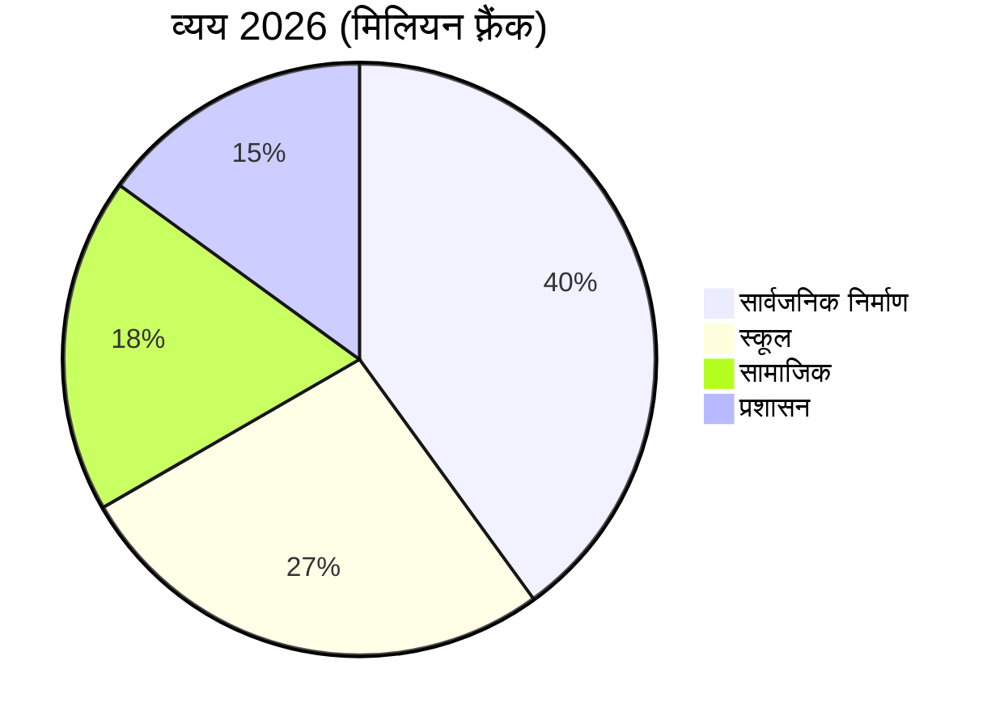

# वार्षिक रिपोर्ट 2026

Montagny ने बीते वर्ष की समीक्षा की: निर्माण परियोजनाएँ पूरी हुईं और एक धरोहर स्थल का जीर्णोद्धार हुआ।


---

## रूपरेखा

1. सार्वजनिक निर्माण कार्य
2. धरोहर
3. वित्त
4. क्षेत्र
5. आगे की राह

---

## झील मार्ग परियोजना

- अप्रैल में पूरी हुई
- तय समय से दो महीने पहले
- लागत 1.8 मिलियन फ़्रैंक
- स्वीकृत राशि से 1,20,000 फ़्रैंक कम
- 900 मीटर पेयजल पाइपलाइन बदली गई


---

## फ़ोंतेन स्कूल

- गर्मियों में ऊष्मा-रोधन
- हीटिंग की खपत घटेगी
- अगली सर्दियों से 35% तक
- छात्र कक्षाओं में लौटे
- अगस्त में, योजना के अनुसार


---

## धरोहर

- सेंट-जाँ चैपल के 15वीं सदी के भित्तिचित्र फिर निखरे
- अठारह महीनों के जीर्णोद्धार के बाद
- निर्देशित भ्रमण वसंत में फिर शुरू
- हर महीने के पहले रविवार को


---

## वित्त

- 2026 के खाते 6 मिलियन फ़्रैंक पर बंद
- स्वीकृत बजट के 2.3% के दायरे में
- सबसे बड़ा हिस्सा सार्वजनिक निर्माण का
- उसके बाद स्कूल

---

## वित्त



---

## क्षेत्र

```leaflet
lat: 46.79
long: 6.83
zoom: 13
marker: 46.792, 6.831, झील मार्ग
marker: 46.787, 6.826, [[फ़ोंतेन स्कूल]]
marker: 46.795, 6.836, सेंट-जाँ चैपल
height: 380px
```

---

## आगे की राह

- सार्वजनिक भवनों का ऊर्जा-नवीनीकरण जारी रहेगा।
- 2027 के बजट में 2,40,000 फ़्रैंक के घाटे का अनुमान।
- घाटे की भरपाई नगरपालिका के भंडार से।
- वसंत में सक्रिय आवागमन पर सार्वजनिक परामर्श।
- नगरपालिका नवीनीकरण का प्रयास जारी रखेगी।


---

## मुख्य बातें

- झील मार्ग परियोजना अप्रैल में, तय समय से दो महीने पहले पूरी हुई।
- फ़ोंतेन स्कूल में गर्मियों में ऊष्मा-रोधन, हीटिंग 35% तक घटेगी।
- अठारह महीनों बाद चैपल के भित्तिचित्र फिर निखरे, भ्रमण वसंत में फिर शुरू।
