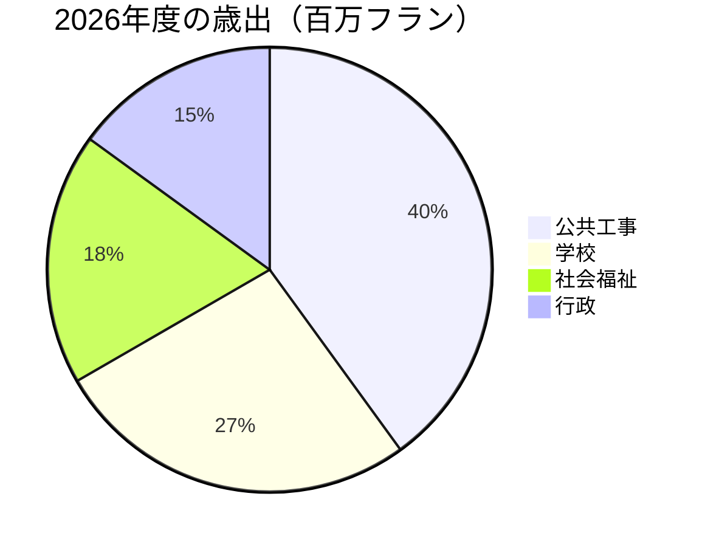

# 2026年 年次報告書

[[Montagny]]町当局がこの1年を振り返る。3件の建設事業が完了し、文化財1件の修復を終え、予算との差は2.3%以内に収まった。


## 公共工事

湖岸通りの工事は4月に完了し、承認済みの工程より2か月早い竣工となった。事業費は180万フランで、町議会が承認した予算額を12万フラン下回った。1962年に敷設された上水道の本管も、900メートルにわたって更新した。

フォンテーヌ校では夏の間に断熱工事を行い、来冬から暖房のエネルギー消費量が35%減る見込みである。児童は予定どおり、8月の新学期から教室に戻った。

街路灯はすべてLEDになった。412基を交換し、各地区への意見聴取を経て、午前1時から5時までは一部を消灯している。


## 文化財

サン＝ジャン礼拝堂は18か月に及ぶ修復を経て、15世紀のフレスコ画を取り戻した。ガイドツアーは春に再開し、毎月第1日曜日に行う。


## 財政

2026年度決算の歳出は600万フランで、承認予算との差は2.3%以内に収まった。最も大きな割合を占めるのは公共工事で、学校がこれに続く。



## 対象地域

3件の事業はいずれも町の南部に位置する。

```leaflet
lat: 46.79
long: 6.83
zoom: 13
marker: 46.792, 6.831, 湖岸通り
marker: 46.787, 6.826, [[フォンテーヌ校]]
marker: 46.795, 6.836, サン＝ジャン礼拝堂
height: 380px
```

## 今後の見通し

町当局は公共施設の省エネ改修を引き続き進める。2027年度予算では24万フランの赤字を見込むが、町の積立金で補填する。また春には、徒歩・自転車による移動（アクティブモビリティ）について住民の意見を募る。


