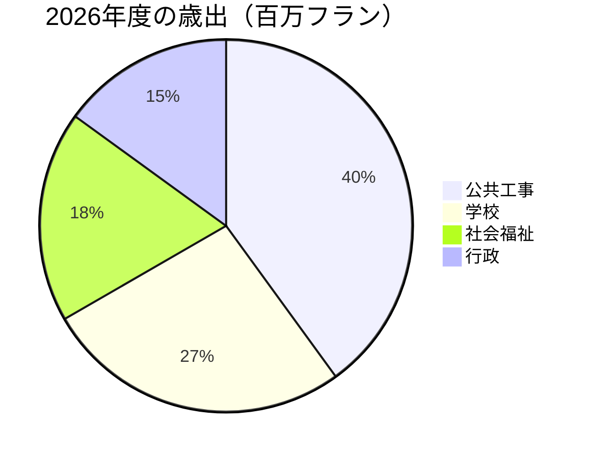

# 2026年 年次報告書

Montagny、建設事業の完了と文化財の修復でこの1年を振り返る。


---

## 目次

1. 公共工事
2. 文化財
3. 財政
4. 対象地域
5. 今後の見通し

---

## 湖岸通りの工事

- 4月に完了
- 予定より2か月早い竣工
- 事業費は180万フラン
- 予算額を12万フラン下回る
- 上水道の本管を900メートル更新


---

## フォンテーヌ校

- 夏の間に断熱工事
- 暖房のエネルギー消費量が減少する見込み
- 来冬から35%削減
- 児童は新学期から教室へ
- 予定どおり8月に再開


---

## 文化財

- サン＝ジャン礼拝堂が15世紀のフレスコ画を取り戻す
- 18か月に及ぶ修復を経て
- ガイドツアーは春に再開
- 毎月第1日曜日に実施


---

## 財政

- 2026年度決算の歳出は600万フラン
- 承認予算との差は2.3%以内
- 最大の割合は公共工事
- 学校がこれに続く

---

## 財政



---

## 対象地域

```leaflet
lat: 46.79
long: 6.83
zoom: 13
marker: 46.792, 6.831, 湖岸通り
marker: 46.787, 6.826, [[フォンテーヌ校]]
marker: 46.795, 6.836, サン＝ジャン礼拝堂
height: 380px
```

---

## 今後の見通し

- 公共施設の省エネ改修を継続。
- 2027年度予算は24万フランの赤字を見込む。
- 赤字は町の積立金で補填。
- 春にアクティブモビリティについて住民の意見を募集。
- 町当局は改修の取り組みを続ける。


---

## 要点

- 湖岸通りの工事は4月に完了、予定より2か月早い竣工。
- フォンテーヌ校は夏に断熱工事、暖房消費は35%減の見込み。
- 礼拝堂は18か月の修復でフレスコ画を取り戻し、ツアーは春に再開。
