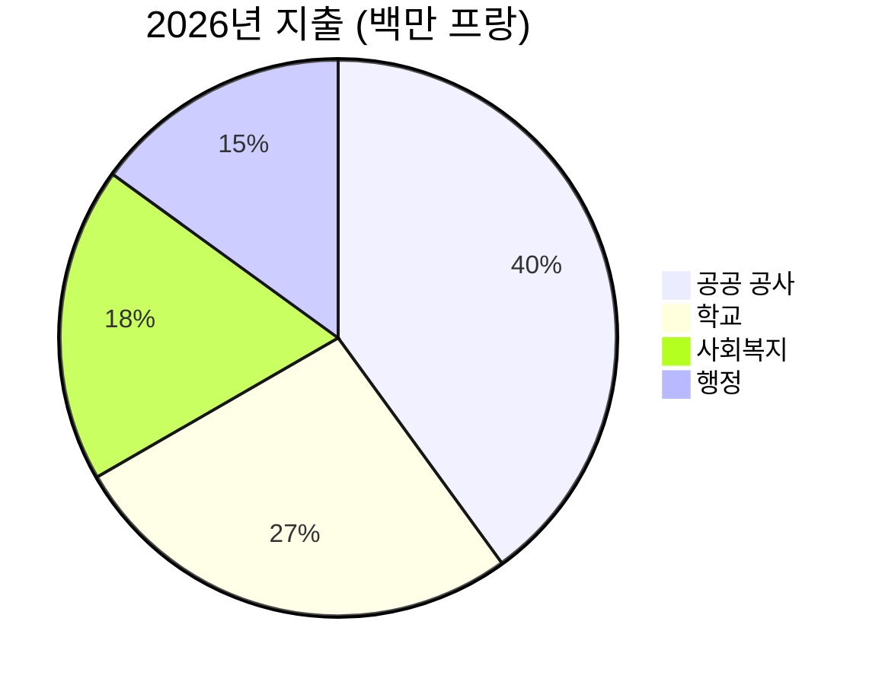

# 2026년 연례 보고서

[[Montagny]] 시는 지난 한 해를 돌아본다. 건설 사업 세 건을 마무리했고, 문화유산 한 곳을 복원했으며,
지출을 예산 대비 2.3% 이내로 관리했다.


## 공공 공사

호숫가 도로 공사는 승인된 일정보다 두 달 앞선 4월에 완공되었다. 공사비는 180만 프랑으로,
시의회가 승인한 예산보다 12만 프랑 적게 들었다. 1962년에 매설된 상수도 본관도 900미터 구간에
걸쳐 교체했다.

퐁텐 학교는 여름 동안 단열 공사를 마쳤다. 올겨울부터 난방 에너지 소비가 35% 줄어들 전망이다.
학생들은 예정대로 8월 개학에 맞춰 교실로 돌아왔다.

가로등은 이제 모두 LED로 바뀌었다. 모두 412개를 교체했으며, 동네별 주민 의견을 수렴한 결과
새벽 1시부터 5시까지는 일부를 소등한다.


## 문화유산

생장 예배당은 18개월에 걸친 복원 끝에 15세기 프레스코화를 되찾았다. 가이드 투어는 봄부터
매달 첫째 일요일에 재개된다.


## 재정

2026년 결산 지출은 600만 프랑으로, 승인 예산과의 차이가 2.3% 이내였다.
공공 공사가 가장 큰 비중을 차지했고, 학교가 그 뒤를 이었다.



## 위치

세 사업 모두 마을 남쪽에 자리한다.

```leaflet
lat: 46.79
long: 6.83
zoom: 13
marker: 46.792, 6.831, 호숫가 도로
marker: 46.787, 6.826, [[퐁텐 학교]]
marker: 46.795, 6.836, 생장 예배당
height: 380px
```

## 전망

시는 공공건물의 에너지 효율 개선을 계속 추진한다. 2027년 예산안은 24만 프랑의 적자를
예상하며, 이는 시 적립금으로 충당한다. 봄에는 보행·자전거 교통에 관한 주민 의견 수렴이
진행된다.


