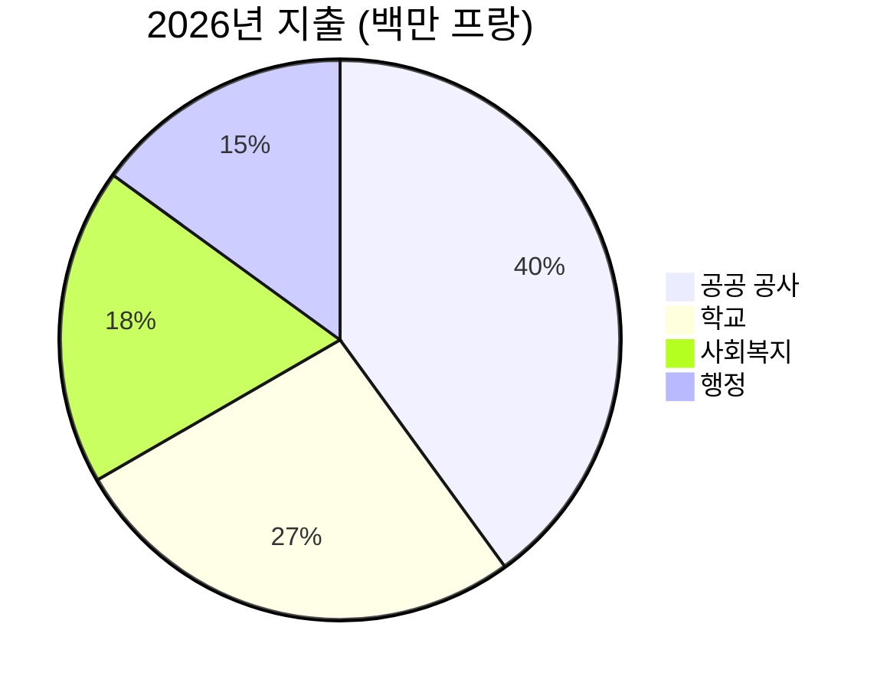

# 2026년 연례 보고서

Montagny 시가 건설 사업 완료와 문화유산 복원으로 지난 한 해를 돌아본다.


---

## 목차

1. 공공 공사
2. 문화유산
3. 재정
4. 위치
5. 전망

---

## 호숫가 도로 공사

- 4월 완공
- 일정보다 두 달 앞당김
- 공사비 180만 프랑
- 승인 예산보다 12만 프랑 절감
- 상수도 본관 900미터 교체


---

## 퐁텐 학교

- 여름 동안 단열 공사
- 난방 에너지 소비 감소 전망
- 올겨울부터 35% 절감
- 학생들은 예정대로
- 8월 개학에 맞춰 복귀


---

## 문화유산

- 생장 예배당, 15세기 프레스코화 되찾아
- 18개월에 걸친 복원 작업
- 봄부터 가이드 투어 재개
- 매달 첫째 일요일 운영


---

## 재정

- 2026년 결산 지출 600만 프랑
- 승인 예산 대비 2.3% 이내
- 공공 공사가 가장 큰 비중
- 학교가 그 뒤를 이음

---

## 재정



---

## 위치

```leaflet
lat: 46.79
long: 6.83
zoom: 13
marker: 46.792, 6.831, 호숫가 도로
marker: 46.787, 6.826, [[퐁텐 학교]]
marker: 46.795, 6.836, 생장 예배당
height: 380px
```

---

## 전망

- 공공건물 에너지 효율 개선 지속
- 2027년 예산안, 24만 프랑 적자 예상
- 적자는 시 적립금으로 충당
- 봄에 보행·자전거 교통 주민 의견 수렴
- 시는 개선 노력을 이어갈 계획


---

## 핵심 요약

- 호숫가 도로 공사, 일정보다 두 달 앞선 4월 완공
- 퐁텐 학교 여름 단열 공사, 난방 소비 35% 감소 전망
- 생장 예배당, 18개월 복원 끝에 프레스코화 되찾아 봄부터 투어 재개
