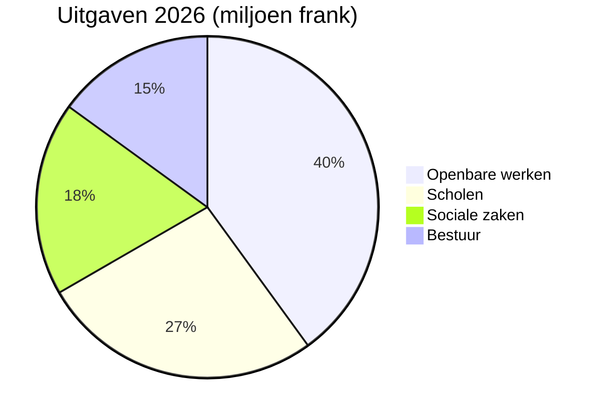

# Jaarverslag 2026

Het gemeentebestuur van [[Montagny]] blikt terug op het afgelopen jaar: drie bouwprojecten
afgerond, een monument gerestaureerd en een begroting die op 2,3% na is nageleefd.


## Openbare werken

De werkzaamheden aan de Meerweg werden in april afgerond, twee maanden eerder dan gepland. Ze
kostten 1,8 miljoen frank, 120.000 frank minder dan het door de gemeenteraad toegekende krediet.
De drinkwaterleiding uit 1962 werd over 900 meter vervangen.

De Fontaineschool werd in de zomer geïsoleerd: het energieverbruik voor verwarming zou vanaf
volgende winter met 35% moeten dalen. De leerlingen keerden zoals gepland bij het begin van het
schooljaar in augustus terug in hun klaslokalen.

De openbare verlichting is nu volledig led: 412 lichtpunten vervangen, met gedeeltelijke
uitschakeling tussen 1 en 5 uur 's nachts, waartoe werd besloten na overleg met de wijken.


## Erfgoed

De kapel Saint-Jean heeft na achttien maanden restauratie haar fresco's uit de 15e eeuw
teruggekregen. De rondleidingen worden in het voorjaar hervat, op de eerste zondag van elke maand.


## Financiën

De rekening 2026 sluit met 6 miljoen frank aan uitgaven, op 2,3% na binnen de goedgekeurde
begroting. Openbare werken vormen de grootste post, vóór de scholen.



## Gebied

De drie projecten liggen alle ten zuiden van het dorp.

```leaflet
lat: 46.79
long: 6.83
zoom: 13
marker: 46.792, 6.831, Meerweg
marker: 46.787, 6.826, [[Fontaineschool]]
marker: 46.795, 6.836, Kapel Saint-Jean
height: 380px
```

## Vooruitzichten

Het gemeentebestuur zet de energierenovatie van de openbare gebouwen voort. De begroting 2027
voorziet in een tekort van 240.000 frank, gedekt door de gemeentelijke reserves, en in het
voorjaar volgt een publieksraadpleging over actieve mobiliteit.


