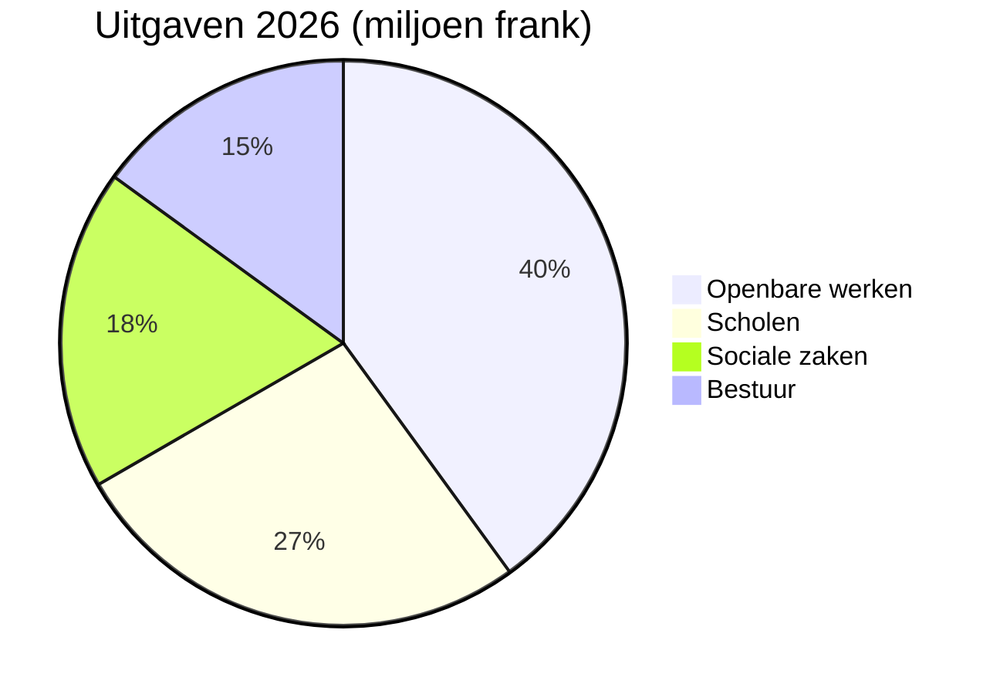

# Jaarverslag 2026

Montagny blikt terug op een jaar met afgeronde bouwprojecten en een gerestaureerd monument.


---

## Inhoud

1. Openbare werken
2. Erfgoed
3. Financiën
4. Gebied
5. Vooruitzichten

---

## Werkzaamheden Meerweg

- Afgerond in april
- Twee maanden eerder dan gepland
- Kosten: 1,8 miljoen frank
- 120.000 frank onder het krediet
- Waterleiding over 900 meter vervangen


---

## Fontaineschool

- In de zomer geïsoleerd
- Verwarmingsverbruik moet dalen
- Met 35% vanaf volgende winter
- Leerlingen terug bij de start
- Schooljaar in augustus, zoals gepland


---

## Erfgoed

- Kapel Saint-Jean heeft fresco's uit de 15e eeuw terug
- Na achttien maanden restauratie
- Rondleidingen hervat in het voorjaar
- Op de eerste zondag van elke maand


---

## Financiën

- Rekening 2026 sluit op 6 miljoen frank
- op 2,3% na binnen de begroting
- Openbare werken vormen de grootste post
- vóór de scholen

---

## Financiën



---

## Gebied

```leaflet
lat: 46.79
long: 6.83
zoom: 13
marker: 46.792, 6.831, Meerweg
marker: 46.787, 6.826, [[Fontaineschool]]
marker: 46.795, 6.836, Kapel Saint-Jean
height: 380px
```

---

## Vooruitzichten

- Energierenovatie van openbare gebouwen gaat door.
- Begroting 2027 voorziet in een tekort van 240.000 frank.
- Tekort gedekt door de gemeentelijke reserves.
- Publieksraadpleging over actieve mobiliteit in het voorjaar.
- Het gemeentebestuur zet de renovatie voort.


---

## Belangrijkste punten

- Werkzaamheden Meerweg afgerond in april, twee maanden eerder.
- Fontaineschool in de zomer geïsoleerd, verwarming moet 35% dalen.
- Kapel kreeg na achttien maanden haar fresco's terug, rondleidingen in het voorjaar.
