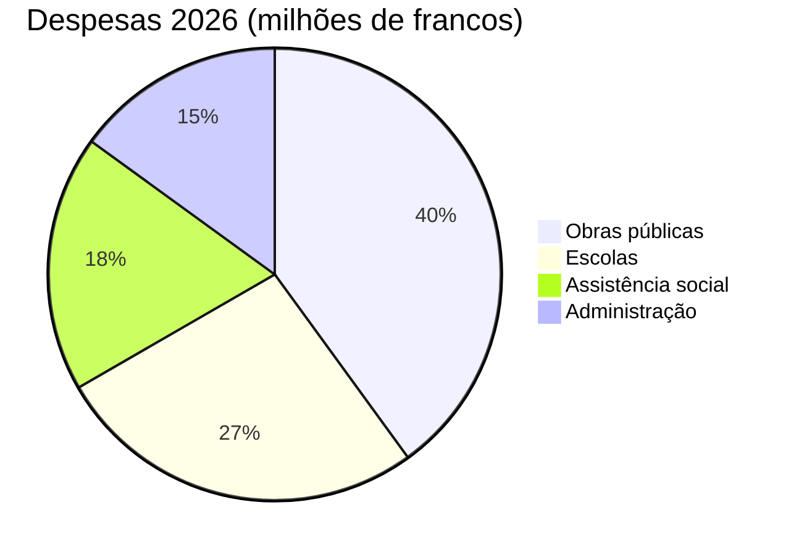

# Relatório anual 2026

O Município de [[Montagny]] faz o balanço do último ano: três obras concluídas, um patrimônio
restaurado e um orçamento cumprido com desvio de apenas 2,3%.


## Obras públicas

A obra da Estrada do Lago foi concluída em abril, dois meses antes do cronograma aprovado. Custou
1,8 milhão de francos, 120.000 francos a menos que o crédito concedido pela Câmara Municipal. A
adutora de água potável, instalada em 1962, foi substituída ao longo de 900 metros.

A Escola Fontaine recebeu isolamento térmico durante o verão: o consumo de aquecimento deve cair
35% a partir do próximo inverno. Os alunos voltaram às salas de aula no início do semestre, em
agosto, como previsto.

A iluminação pública agora é totalmente em LED: 412 luminárias substituídas, com desligamento
parcial entre 1h e 5h, decidido após consulta aos bairros.


## Patrimônio

A capela de Saint-Jean recuperou seus afrescos do século XV após dezoito meses de restauração.
As visitas guiadas serão retomadas na primavera, no primeiro domingo de cada mês.


## Finanças

As contas de 2026 fecham com 6 milhões de francos de despesas, com desvio de 2,3% em relação ao
orçamento aprovado. As obras públicas respondem pela maior parte, à frente das escolas.



## Localização

Os três projetos ficam ao sul do vilarejo.

```leaflet
lat: 46.79
long: 6.83
zoom: 13
marker: 46.792, 6.831, Estrada do Lago
marker: 46.787, 6.826, [[Escola Fontaine]]
marker: 46.795, 6.836, Capela de Saint-Jean
height: 380px
```

## Perspectivas

O Município dará continuidade à renovação energética dos prédios públicos. O orçamento de 2027
prevê um déficit de 240.000 francos, coberto pelas reservas municipais, e uma consulta pública
sobre mobilidade ativa será realizada na primavera.


