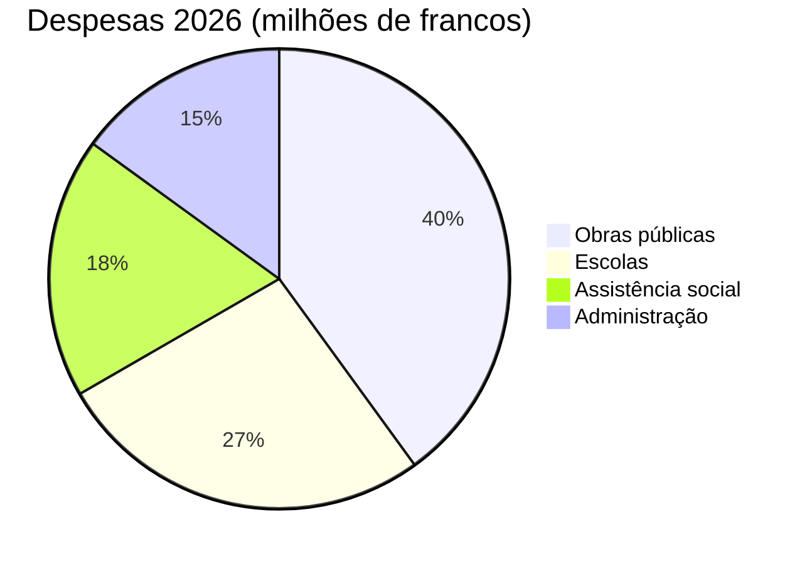

# Relatório anual 2026

Montagny faz o balanço do último ano, com obras concluídas e um patrimônio restaurado.


---

## Sumário

1. Obras públicas
2. Patrimônio
3. Finanças
4. Localização
5. Perspectivas

---

## Obra da Estrada do Lago

- Concluída em abril
- Dois meses antes do previsto
- Custo de 1,8 milhão de francos
- 120.000 francos abaixo do crédito
- Adutora substituída ao longo de 900 metros


---

## Escola Fontaine

- Isolamento térmico durante o verão
- Consumo de aquecimento em queda
- 35% a menos a partir do próximo inverno
- Alunos de volta no início
- Do semestre de agosto, como previsto


---

## Patrimônio

- Capela de Saint-Jean recupera afrescos do século XV
- Após dezoito meses de restauração
- Visitas guiadas retomadas na primavera
- No primeiro domingo de cada mês


---

## Finanças

- Contas de 2026 fecham em 6 milhões de francos
- desvio de 2,3% em relação ao orçamento aprovado
- Obras públicas respondem pela maior parte
- à frente das escolas

---

## Finanças



---

## Localização

```leaflet
lat: 46.79
long: 6.83
zoom: 13
marker: 46.792, 6.831, Estrada do Lago
marker: 46.787, 6.826, [[Escola Fontaine]]
marker: 46.795, 6.836, Capela de Saint-Jean
height: 380px
```

---

## Perspectivas

- Renovação energética continua nos prédios públicos.
- Orçamento de 2027 prevê déficit de 240.000 francos.
- Déficit coberto pelas reservas municipais.
- Consulta pública sobre mobilidade ativa na primavera.
- Município manterá o esforço de renovação.


---

## Pontos principais

- Obra da Estrada do Lago concluída em abril, dois meses antes.
- Escola Fontaine isolada no verão, aquecimento deve cair 35%.
- Capela recupera afrescos após dezoito meses, visitas voltam na primavera.
