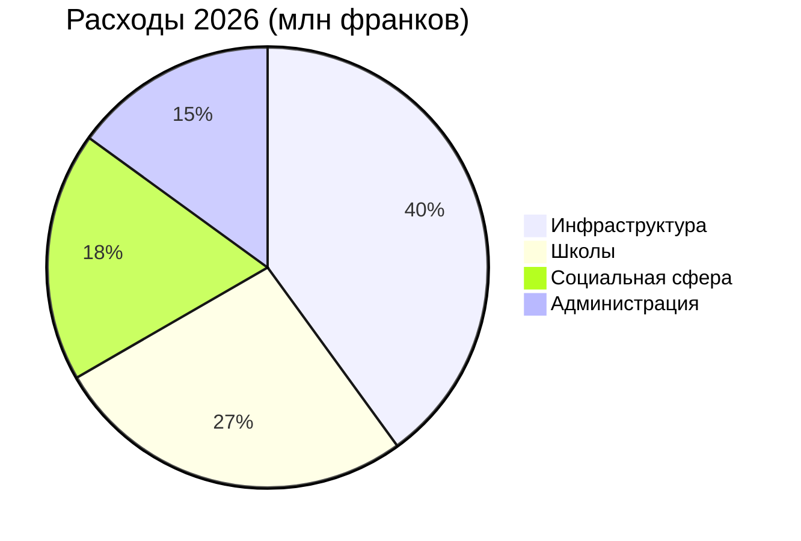

# Годовой отчёт 2026

Муниципалитет коммуны [[Montagny]] подводит итоги прошедшего года: завершены три строительных
проекта, отреставрирован памятник культурного наследия, а бюджет исполнен с отклонением не более 2,3 %.


## Инфраструктура

Работы на Озёрной дороге завершены в апреле — на два месяца раньше утверждённого графика. Они
обошлись в 1,8 млн франков, на 120 000 франков меньше кредита, выделенного муниципальным советом.
Водопровод питьевой воды, проложенный в 1962 году, заменён на участке длиной 900 метров.

Летом утеплили школу Фонтен: со следующей зимы расход тепла на отопление должен снизиться на 35 %.
Ученики вернулись в классы к началу учебного года в августе, как и планировалось.

Уличное освещение теперь полностью светодиодное: заменено 412 светильников, а с 1 до 5 часов утра
действует частичное отключение — решение принято после консультаций с жителями кварталов.


## Культурное наследие

Часовня Сен-Жан после восемнадцати месяцев реставрации вновь обрела фрески XV века. Экскурсии
возобновятся весной — в первое воскресенье каждого месяца.


## Финансы

Расходы по счетам 2026 года составили 6 млн франков — в пределах 2,3 % от утверждённого бюджета.
Наибольшая доля приходится на инфраструктуру, на втором месте — школы.



## Расположение

Все три объекта находятся к югу от деревни.

```leaflet
lat: 46.79
long: 6.83
zoom: 13
marker: 46.792, 6.831, Озёрная дорога
marker: 46.787, 6.826, [[Школа Фонтен]]
marker: 46.795, 6.836, Часовня Сен-Жан
height: 380px
```

## Перспективы

Муниципалитет продолжит энергетическую модернизацию общественных зданий. Бюджет на 2027 год
предусматривает дефицит в 240 000 франков, который покроют муниципальные резервы, а весной пройдут
общественные консультации по развитию пешеходного и велосипедного движения.


