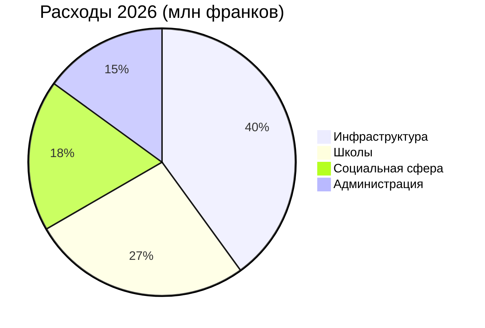

# Годовой отчёт 2026

Montagny подводит итоги года: завершённые стройки и отреставрированный памятник.


---

## План

1. Инфраструктура
2. Культурное наследие
3. Финансы
4. Расположение
5. Перспективы

---

## Озёрная дорога

- Работы завершены в апреле
- На два месяца раньше срока
- Стоимость 1,8 млн франков
- На 120 000 франков меньше кредита
- Водопровод заменён на 900 метрах


---

## Школа Фонтен

- Утеплена летом
- Расход на отопление снизится
- На 35 % со следующей зимы
- Ученики вернулись в классы
- В августе, как и планировалось


---

## Культурное наследие

- Часовня Сен-Жан вновь обрела фрески XV века
- После восемнадцати месяцев реставрации
- Экскурсии возобновятся весной
- В первое воскресенье каждого месяца


---

## Финансы

- Расходы 2026 года — 6 млн франков
- В пределах 2,3 % от утверждённого бюджета
- Наибольшая доля — инфраструктура
- На втором месте — школы

---

## Финансы



---

## Расположение

```leaflet
lat: 46.79
long: 6.83
zoom: 13
marker: 46.792, 6.831, Озёрная дорога
marker: 46.787, 6.826, [[Школа Фонтен]]
marker: 46.795, 6.836, Часовня Сен-Жан
height: 380px
```

---

## Перспективы

- Энергетическая модернизация общественных зданий продолжается.
- Бюджет 2027 года предусматривает дефицит в 240 000 франков.
- Дефицит покроют муниципальные резервы.
- Весной — консультации по велопешеходному движению.
- Муниципалитет продолжит модернизацию.


---

## Главное

- Озёрная дорога готова в апреле, на два месяца раньше срока.
- Школа Фонтен утеплена летом, расход на отопление снизится на 35 %.
- Фрески часовни восстановлены за восемнадцать месяцев, экскурсии — с весны.
