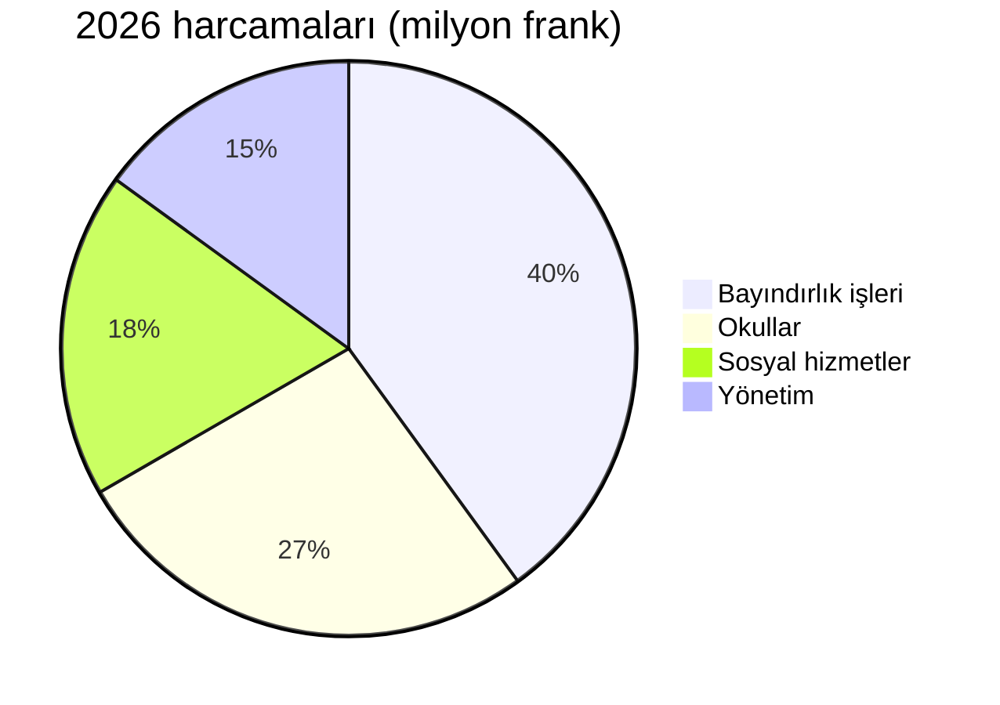

# 2026 Faaliyet Raporu

[[Montagny]] Belediyesi geride kalan yılı değerlendiriyor: üç yapım projesi tamamlandı, tarihî bir
yapı restore edildi ve harcamalar bütçenin %2,3'lük sapma payı içinde tutuldu.


## Bayındırlık işleri

Göl Yolu projesi nisan ayında, onaylanan takvimden iki ay önce tamamlandı. Proje 1,8 milyon franka
mal oldu; bu tutar, Belediye Meclisinin ayırdığı ödenekten 120.000 frank daha az. 1962'de döşenen
içme suyu ana hattı 900 metre boyunca yenilendi.

Fontaine Okulu yaz boyunca yalıtıldı: önümüzdeki kıştan itibaren ısınma tüketiminin %35 azalması
bekleniyor. Öğrenciler, planlandığı gibi ağustos ayında başlayan dönemde sınıflarına döndü.

Sokak aydınlatması artık tamamen LED: 412 armatür değiştirildi. Mahallelere danışıldıktan sonra,
saat 01.00 ile 05.00 arasında kısmi karartma uygulanmasına karar verildi.


## Kültürel miras

Saint-Jean Şapeli, on sekiz ay süren restorasyonun ardından 15. yüzyıldan kalma fresklerine yeniden
kavuştu. Rehberli turlar ilkbaharda, her ayın ilk pazar günü yeniden başlayacak.


## Mali durum

2026 hesapları 6 milyon frank harcamayla kapanıyor; onaylanan bütçeden sapma %2,3 ile sınırlı kaldı.
En büyük payı bayındırlık işleri alıyor, onu okullar izliyor.



## Bölge

Üç proje de köyün güneyinde yer alıyor.

```leaflet
lat: 46.79
long: 6.83
zoom: 13
marker: 46.792, 6.831, Göl Yolu
marker: 46.787, 6.826, [[Fontaine Okulu]]
marker: 46.795, 6.836, Saint-Jean Şapeli
height: 380px
```

## Beklentiler

Belediye, kamu binalarının enerji verimliliği yenilemesini sürdürecek. 2027 bütçesi, belediye
rezervlerinden karşılanacak 240.000 franklık bir açık öngörüyor; aktif ulaşım konusunda bir halk
danışması da ilkbaharda yapılacak.


