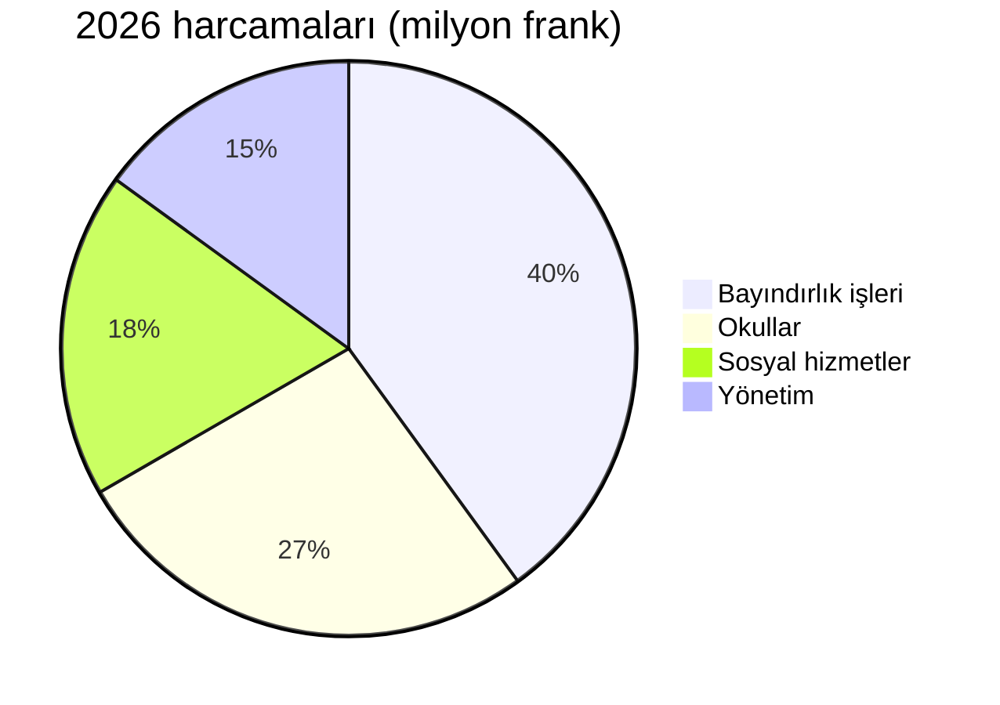

# 2026 Faaliyet Raporu

Montagny, tamamlanan yapım projeleri ve restore edilen tarihî yapıyla geride kalan yılı değerlendiriyor.


---

## İçindekiler

1. Bayındırlık işleri
2. Kültürel miras
3. Mali durum
4. Bölge
5. Beklentiler

---

## Göl Yolu projesi

- Nisan ayında tamamlandı
- Takvimden iki ay önce
- Maliyeti 1,8 milyon frank
- Ödenekten 120.000 frank daha az
- Su ana hattı 900 metre boyunca yenilendi


---

## Fontaine Okulu

- Yaz boyunca yalıtıldı
- Isınma tüketimi azalacak
- Önümüzdeki kıştan itibaren %35
- Öğrenciler sınıflarına döndü
- Ağustos döneminde, planlandığı gibi


---

## Kültürel miras

- Saint-Jean Şapeli 15. yüzyıl fresklerine kavuştu
- On sekiz aylık restorasyonun ardından
- Rehberli turlar ilkbaharda yeniden başlıyor
- Her ayın ilk pazar günü


---

## Mali durum

- 2026 hesapları 6 milyon frankla kapanıyor
- bütçeden sapma %2,3 ile sınırlı
- En büyük pay bayındırlık işlerinde
- ardından okullar geliyor

---

## Mali durum



---

## Bölge

```leaflet
lat: 46.79
long: 6.83
zoom: 13
marker: 46.792, 6.831, Göl Yolu
marker: 46.787, 6.826, [[Fontaine Okulu]]
marker: 46.795, 6.836, Saint-Jean Şapeli
height: 380px
```

---

## Beklentiler

- Kamu binalarında enerji yenilemesi sürüyor.
- 2027 bütçesi 240.000 franklık açık öngörüyor.
- Açık, belediye rezervlerinden karşılanacak.
- Aktif ulaşım için ilkbaharda halk danışması.
- Belediye yenileme çalışmalarını sürdürecek.


---

## Öne çıkanlar

- Göl Yolu projesi nisan ayında, takvimden iki ay önce tamamlandı.
- Fontaine Okulu yaz boyunca yalıtıldı, ısınma tüketimi %35 azalacak.
- Şapel on sekiz ayın ardından fresklerine kavuştu, turlar ilkbaharda başlıyor.
