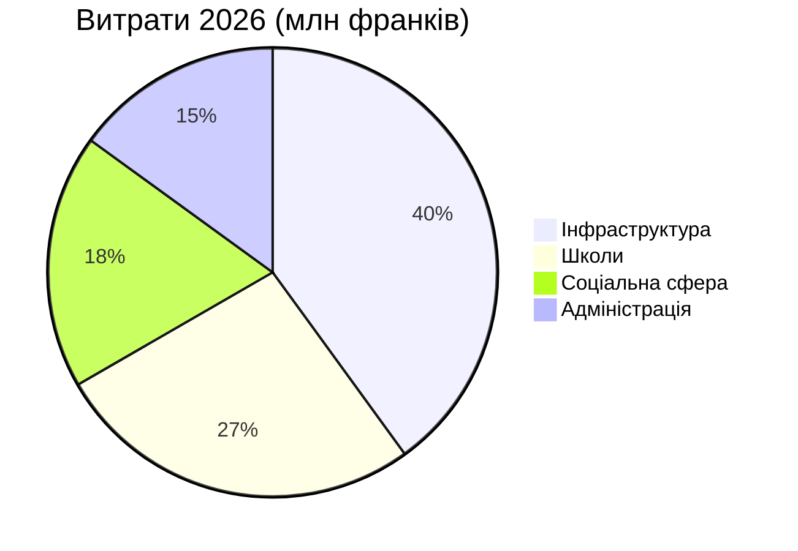

# Річний звіт 2026

Муніципалітет [[Montagny]] підбиває підсумки минулого року: три будівельні проєкти завершено,
пам’ятку відреставровано, а бюджет витримано з відхиленням не більше ніж 2,3%.


## Інфраструктурні роботи

Реконструкцію вулиці Озерної завершили у квітні — на два місяці раніше за затверджений графік.
Роботи коштували 1,8 млн франків, тобто на 120 000 франків менше, ніж кредит, виділений
муніципальною радою. Водогін, прокладений 1962 року, замінили на ділянці завдовжки 900 метрів.

Школу «Фонтен» утеплили влітку: споживання тепла на опалення має скоротитися на 35% уже з
наступної зими. Учні повернулися до класів на початку навчального року в серпні, як і планувалося.

Вуличне освітлення тепер повністю світлодіодне: замінено 412 світильників, а з 1-ї до 5-ї години
ночі діє часткове вимкнення, запроваджене після консультацій із мешканцями кварталів.


## Спадщина

Каплиця Святого Іоанна після вісімнадцяти місяців реставрації знову має свої фрески XV століття.
Екскурсії відновляться навесні — щоразу в першу неділю місяця.


## Фінанси

Рахунки за 2026 рік закриваються з витратами 6 млн франків — у межах 2,3% від затвердженого
бюджету. Найбільша частка припадає на інфраструктурні роботи, далі йдуть школи.



## Розташування

Усі три об’єкти розташовані на південь від села.

```leaflet
lat: 46.79
long: 6.83
zoom: 13
marker: 46.792, 6.831, Вулиця Озерна
marker: 46.787, 6.826, [[Школа «Фонтен»]]
marker: 46.795, 6.836, Каплиця Святого Іоанна
height: 380px
```

## Перспективи

Муніципалітет продовжить енергетичну модернізацію громадських будівель. Бюджет на 2027 рік
передбачає дефіцит у 240 000 франків, покритий із муніципальних резервів, а навесні відбудуться
громадські консультації щодо активної мобільності.


