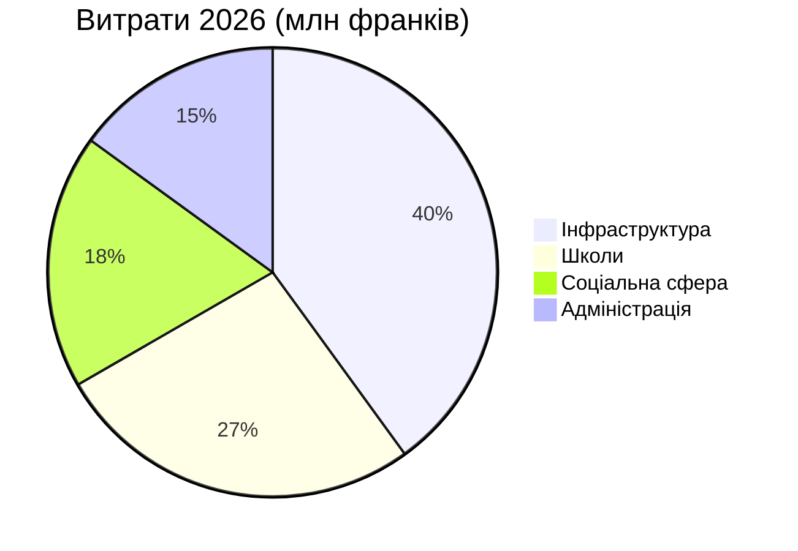

# Річний звіт 2026

Montagny підбиває підсумки року: будівельні проєкти завершено, пам’ятку відреставровано.


---

## План

1. Інфраструктурні роботи
2. Спадщина
3. Фінанси
4. Розташування
5. Перспективи

---

## Вулиця Озерна

- Завершено у квітні
- На два місяці раніше
- Вартість 1,8 млн франків
- На 120 000 франків менше за кредит
- Водогін замінено на 900 метрах


---

## Школа «Фонтен»

- Утеплено влітку
- Опалення має скоротитися
- На 35% з наступної зими
- Учні повернулися вчасно
- Серпневий початок року за планом


---

## Спадщина

- Каплиця Святого Іоанна знову має фрески XV століття
- Після вісімнадцяти місяців реставрації
- Екскурсії відновляться навесні
- У першу неділю кожного місяця


---

## Фінанси

- Рахунки 2026 року: 6 млн франків
- У межах 2,3% від затвердженого бюджету
- Найбільша частка — інфраструктурні роботи
- Далі йдуть школи

---

## Фінанси



---

## Розташування

```leaflet
lat: 46.79
long: 6.83
zoom: 13
marker: 46.792, 6.831, Вулиця Озерна
marker: 46.787, 6.826, [[Школа «Фонтен»]]
marker: 46.795, 6.836, Каплиця Святого Іоанна
height: 380px
```

---

## Перспективи

- Енергомодернізація громадських будівель триває.
- Бюджет 2027 року передбачає дефіцит 240 000 франків.
- Дефіцит покривають муніципальні резерви.
- Навесні — консультації щодо активної мобільності.
- Муніципалітет продовжить модернізацію.


---

## Головні висновки

- Вулицю Озерну завершено у квітні, на два місяці раніше.
- Школу «Фонтен» утеплено влітку, опалення скоротиться на 35%.
- Каплиця знову має фрески після вісімнадцяти місяців, екскурсії — навесні.
