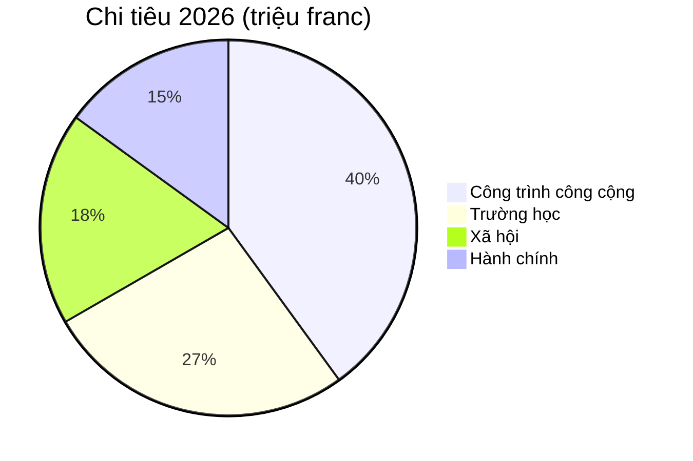

# Báo cáo thường niên 2026

Chính quyền xã [[Montagny]] nhìn lại năm qua: ba công trình xây dựng hoàn thành,
một di tích được trùng tu và ngân sách được giữ trong biên độ 2,3%.


## Công trình công cộng

Dự án đường Ven Hồ hoàn thành vào tháng Tư, sớm hai tháng so với tiến độ được phê duyệt. Chi phí
là 1,8 triệu franc, thấp hơn 120.000 franc so với khoản kinh phí Hội đồng xã đã cấp. Tuyến ống
nước sinh hoạt, lắp đặt từ năm 1962, đã được thay mới trên chiều dài 900 mét.

Trường Fontaine được cách nhiệt trong mùa hè: mức tiêu thụ cho sưởi ấm dự kiến giảm 35% kể từ
mùa đông tới. Học sinh đã trở lại lớp vào đầu học kỳ tháng Tám, đúng kế hoạch.

Hệ thống chiếu sáng công cộng nay hoàn toàn dùng đèn LED: 412 đèn đã được thay, kèm chế độ tắt
một phần từ 1 giờ đến 5 giờ sáng, được quyết định sau khi tham vấn các khu phố.


## Di sản

Nhà nguyện Saint-Jean đã tìm lại các bức bích họa thế kỷ 15 sau mười tám tháng trùng tu. Các
chuyến tham quan có hướng dẫn sẽ trở lại vào mùa xuân, vào Chủ nhật đầu tiên của mỗi tháng.


## Tài chính

Quyết toán năm 2026 khép lại với 6 triệu franc chi tiêu, trong biên độ 2,3% so với ngân sách được
duyệt. Công trình công cộng chiếm phần lớn nhất, tiếp đến là trường học.



## Khu vực

Cả ba công trình đều nằm ở phía nam làng.

```leaflet
lat: 46.79
long: 6.83
zoom: 13
marker: 46.792, 6.831, Đường Ven Hồ
marker: 46.787, 6.826, [[Trường Fontaine]]
marker: 46.795, 6.836, Nhà nguyện Saint-Jean
height: 380px
```

## Triển vọng

Chính quyền xã sẽ tiếp tục cải tạo năng lượng cho các công trình công cộng. Ngân sách 2027 dự kiến
thâm hụt 240.000 franc, được bù đắp bằng quỹ dự trữ của xã, và một cuộc tham vấn cộng đồng về
giao thông phi cơ giới sẽ diễn ra vào mùa xuân.


