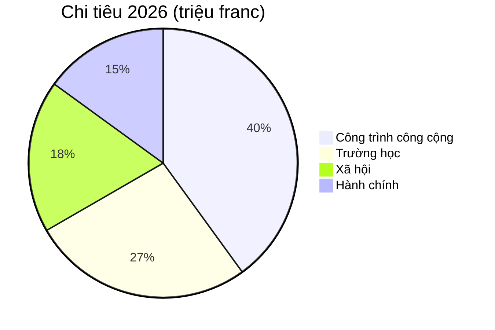

# Báo cáo thường niên 2026

Montagny nhìn lại năm qua với các công trình đã hoàn thành và một di tích được trùng tu.


---

## Nội dung

1. Công trình công cộng
2. Di sản
3. Tài chính
4. Khu vực
5. Triển vọng

---

## Dự án đường Ven Hồ

- Hoàn thành vào tháng Tư
- Sớm hai tháng so với tiến độ
- Chi phí 1,8 triệu franc
- Thấp hơn kinh phí được cấp 120.000 franc
- Thay ống nước trên 900 mét


---

## Trường Fontaine

- Cách nhiệt trong mùa hè
- Tiêu thụ cho sưởi ấm sẽ giảm
- 35% kể từ mùa đông tới
- Học sinh trở lại lớp
- Đầu học kỳ tháng Tám, đúng kế hoạch


---

## Di sản

- Nhà nguyện Saint-Jean tìm lại bích họa thế kỷ 15
- Sau mười tám tháng trùng tu
- Tham quan có hướng dẫn trở lại vào mùa xuân
- Vào Chủ nhật đầu tiên mỗi tháng


---

## Tài chính

- Quyết toán 2026: 6 triệu franc chi tiêu
- Trong biên độ 2,3% so với ngân sách
- Công trình công cộng chiếm phần lớn nhất
- Tiếp đến là trường học

---

## Tài chính



---

## Khu vực

```leaflet
lat: 46.79
long: 6.83
zoom: 13
marker: 46.792, 6.831, Đường Ven Hồ
marker: 46.787, 6.826, [[Trường Fontaine]]
marker: 46.795, 6.836, Nhà nguyện Saint-Jean
height: 380px
```

---

## Triển vọng

- Tiếp tục cải tạo năng lượng các công trình công cộng.
- Ngân sách 2027 dự kiến thâm hụt 240.000 franc.
- Thâm hụt được bù bằng quỹ dự trữ của xã.
- Tham vấn cộng đồng về giao thông phi cơ giới vào mùa xuân.
- Chính quyền xã duy trì nỗ lực cải tạo.


---

## Những điểm chính

- Dự án đường Ven Hồ hoàn thành vào tháng Tư, sớm hai tháng.
- Trường Fontaine được cách nhiệt trong mùa hè, tiêu thụ sưởi ấm sẽ giảm 35%.
- Nhà nguyện tìm lại bích họa sau mười tám tháng, tham quan trở lại vào mùa xuân.
