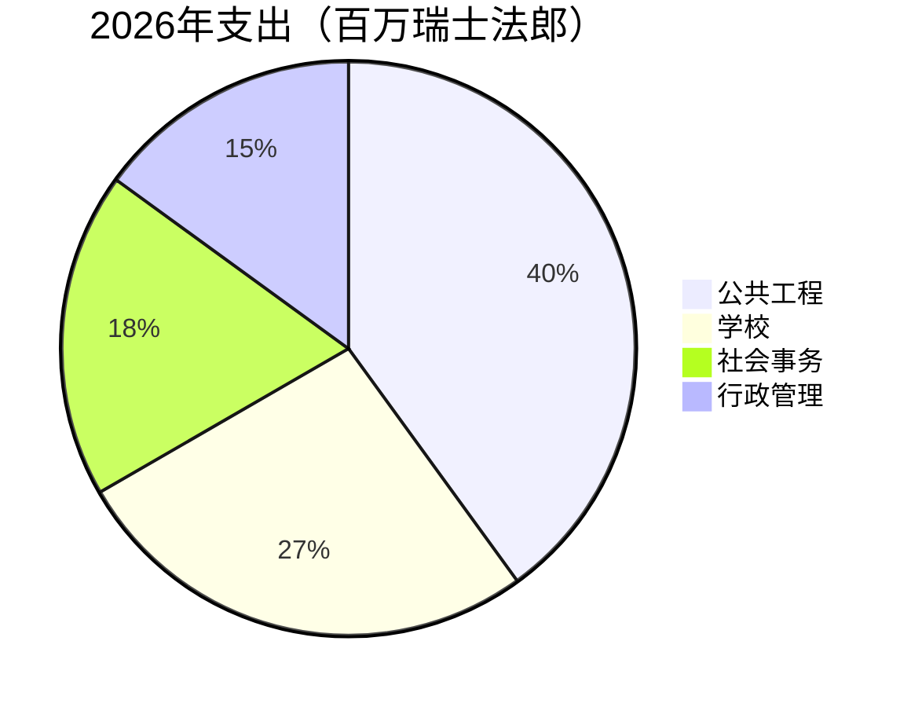

# 2026年度报告

[[Montagny]]镇政府回顾过去一年：三项建设工程竣工，一处文化遗产修复完毕，预算执行偏差控制在2.3%以内。


## 公共工程

湖滨路工程于4月竣工，比批准的工期提前两个月。工程耗资180万瑞士法郎，比镇议会批准的拨款少12万瑞士法郎。铺设于1962年的饮用水主管道也同步更换，长度达900米。

方丹学校在夏季完成了保温改造：自明年冬季起，供暖能耗预计将下降35%。学生们按计划在8月开学时重返教室。

路灯现已全部改用LED：共更换412盏，并在征求各街区意见后，于凌晨1点至5点实行部分熄灯。


## 文化遗产

圣让礼拜堂历经十八个月修复，重现了15世纪的壁画。导览参观将于春季恢复，每月第一个星期日举行。


## 财务

2026年账目支出为600万瑞士法郎，与批准预算的偏差在2.3%以内。公共工程占比最大，其次是学校。



## 区域

三个项目均位于镇区南部。

```leaflet
lat: 46.79
long: 6.83
zoom: 13
marker: 46.792, 6.831, 湖滨路
marker: 46.787, 6.826, [[方丹学校]]
marker: 46.795, 6.836, 圣让礼拜堂
height: 380px
```

## 展望

镇政府将继续推进公共建筑的节能改造。2027年预算预计赤字24万瑞士法郎，由市镇储备金弥补；春季还将就慢行交通开展公众咨询。


