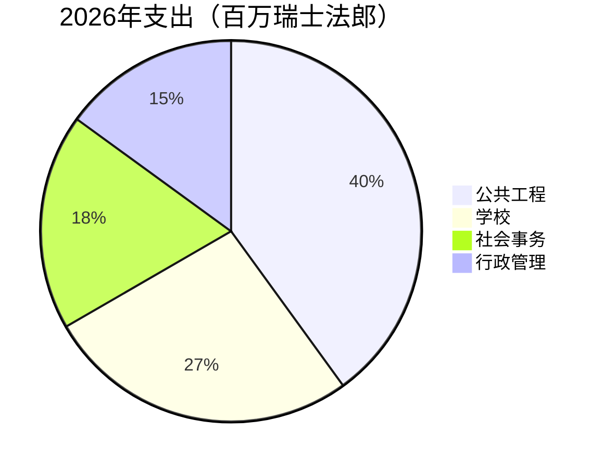

# 2026年度报告

Montagny回顾过去一年：建设工程顺利竣工，文化遗产修复完毕。


---

## 目录

1. 公共工程
2. 文化遗产
3. 财务
4. 区域
5. 展望

---

## 湖滨路工程

- 4月竣工
- 比工期提前两个月
- 耗资180万瑞士法郎
- 比拨款少12万瑞士法郎
- 更换900米饮用水主管道


---

## 方丹学校

- 夏季完成保温改造
- 供暖能耗将明显下降
- 自明年冬季起降幅达35%
- 学生按计划返校
- 8月学期如期开学


---

## 文化遗产

- 圣让礼拜堂重现15世纪壁画
- 历经十八个月修复
- 导览参观将于春季恢复
- 每月第一个星期日举行


---

## 财务

- 2026年账目支出600万瑞士法郎
- 与批准预算偏差在2.3%以内
- 公共工程占比最大
- 其次是学校

---

## 财务



---

## 区域

```leaflet
lat: 46.79
long: 6.83
zoom: 13
marker: 46.792, 6.831, 湖滨路
marker: 46.787, 6.826, [[方丹学校]]
marker: 46.795, 6.836, 圣让礼拜堂
height: 380px
```

---

## 展望

- 公共建筑节能改造继续推进。
- 2027年预算预计赤字24万瑞士法郎。
- 赤字由市镇储备金弥补。
- 春季就慢行交通开展公众咨询。
- 镇政府将持续推进改造工作。


---

## 要点回顾

- 湖滨路工程4月竣工，比工期提前两个月。
- 方丹学校夏季完成保温改造，供暖能耗预计下降35%。
- 圣让礼拜堂历经十八个月修复重现壁画，导览参观春季恢复。
